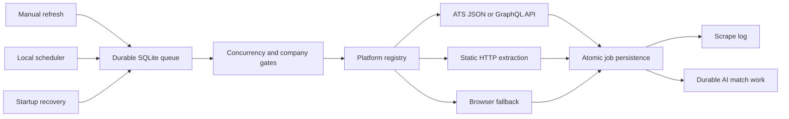

# Scraper architecture

Switchy runs its scraping pipeline entirely on the user's device. SQLite is the durable coordinator; there is no cloud queue, remote worker service, Redis dependency, or external control plane.

## Runtime flow

Manual and scheduled requests use the same in-process supervisor. Each company is represented by a durable queue item with an attempt count, retry time, cancellation flag, worker lease, and serialized result. A process restart recovers expired leases and continues unfinished work.

Synchronous batch callers coalesce identical in-flight company batches. Manual HTTP submissions retain separate durable sessions. Company locks and committed-result reuse prevent overlapping sessions from fetching the same company twice. Stored queue timestamps have one-second precision, so requests in the same second can reuse the earlier result.

## Module boundaries

`createLocalScrapeQueueService()` and `getLocalScrapeQueueService()` are the public composition boundary. The factory accepts a database, HTTP/browser clients, persistence ports, clock, matching callbacks, and runtime checks. The one-company pipeline imports no global AI configuration or dispatcher. Production defaults are wired only in the composition root. The queue service is a thin façade for enqueueing, waiting, recovery, and cancellation; batch work never bypasses the durable queue.

- `application/` owns the one-company pipeline, work handler, session projection, and retention policy.
- `lib/runtime/` owns shared leased work, heartbeats, bounded retry, single-flight dispatch, data maintenance gates, keyed locks, and device sleep protection. Scraping and matching supply their own rate-limit policies.
- `lib/scraper/runtime/` owns scraper resource limits and device-wake checks.
- `queue/`, `history.ts`, and `maintenance/` adapt scraper persistence ports to the existing SQLite schema. `lib/ai/work-items/` owns durable matching work.
- `platforms/` owns extraction only. Shared listing selection preserves platform object identity while applying early filters and existing-ID exclusion; detail hydration is bounded and cancellation-aware.
- `settings/` is the typed source for scraper concurrency, filters, and retention defaults.

The durable match handoff is created in the same transaction as committed scrape results. Post-scrape, manual, company, and unmatched matching all create `aiWorkItems` and use the same durable match-session lifecycle. The local worker reports claim, progress, retry, completion, cancellation, and recovery transitions through the shared leased-work runtime.

## Extraction strategy

The preferred order is:

1. Use a documented or stable ATS JSON/GraphQL endpoint when one is available.
2. Use direct HTTP extraction for server-rendered listing pages.
3. Use the browser transport only when JavaScript execution, cookies, or anti-CSRF behavior requires it.
4. Keep platform-specific selectors and request logic behind the scraper registry.

This hybrid approach remains the right fit for a local application. Replacing every scraper with a headless browser would increase memory usage and failure surface. Replacing platform adapters with a generic AI extraction step would make results slower, less deterministic, and harder to test. AI-assisted extraction can be added later as an explicit fallback, but should not become the primary path for ATS platforms with structured endpoints.

External payload validation is strict for the response envelope and job identity fields, but tolerant of optional, nullable, and polymorphic metadata. Workday accepts null optional listing metadata, reports the names of rejected fields without logging payload values, and keeps malformed or incomplete lists partial. Eightfold first-page failures retain the fetch stage, offset and HTTP status. When some jobs are malformed, adapters retain usable jobs, mark listing completeness as partial, and prevent missing-job archival.

Queue items use a static platform priority derived from production history. Eightfold is ranked first, Workday next, and fast HTTP adapters follow. The ordered queue interleaves one fast adapter after every two long-running items. This starts long jobs early, keeps an HTTP lane busy, and remains deterministic.

All adapters share the user-configured total concurrency budget. Actual browser lifetimes share a two-browser gate inside the browser client. HTTP-only Eightfold and Workday runs do not occupy browser permits. Workday retains its global company serialization and paced host requests. Separate sessions cannot scrape the same company simultaneously.

Queue admission enforces serialization before leasing work. While a Workday
company is running, other Workday companies stay queued without consuming
workers or execution permits. The claim transaction also excludes companies
already running in another session. URL detection covers legacy records without
a valid saved platform. The in-process Workday lock remains a safety guard for
direct scraper calls; the browser-limited classification also reserves general
HTTP execution capacity. Admission constraints live in
`services/execution-policy.ts`, independently of browser allocation.

Adapter results and pipeline exceptions use the same failure classifier in `lib/scraper/types/validation.ts`. It preserves HTTP status and retry hints, distinguishes cancellation from timeout, and keeps retry decisions consistent with terminal scrape logging.

## Reliability guarantees

- Session creation and queue insertion are one SQLite transaction.
- Queue claims use leases and atomic compare-and-update transitions.
- Retryable scraper errors use bounded exponential backoff and honor a platform retry delay.
- Job synchronization, company metadata, audit logging, and the matching handoff commit atomically.
- If the process stops after job persistence but before queue completion, the queue result is rebuilt from the committed scrape log instead of scraping again.
- Startup recovery handles expired work and schedules future retry or lease times.
- A large heartbeat clock gap pauses every active leased task, including tasks waiting at resource gates. Interrupted tasks are deferred for at least one minute without spending a network retry attempt, even on the final attempt. Cancellation still takes precedence over deferral.
- Browser-session bootstrap failures identify the sanitized launch, navigation, settle, or session-extraction stage without persisting cookies, tokens, headers, or response bodies.
- On macOS, dispatch checks system CPU, Graphics and Network capabilities before recovering leases or claiming work. CPU/network-only maintenance DarkWake defers dispatch for a minute; recovery remains backend-owned and needs no open browser tab. If the OS probe is unavailable, dispatch falls back to clock-gap recovery with a warning.
- Eightfold and Workday retry missing list offsets with one refreshed browser session before committing a partial result. Workday also retries failed details once and retains listing-only jobs when hydration remains unavailable.
- Uber and Oracle use shared native recruitingCE schemas, URL construction, pagination and completeness handling, with separate tenant configuration and field mapping. Oracle retains overlapping pages to limit pagination drift.
- ServiceNow reads the complete XML feed in one request. It does not perform HTML pagination or per-job detail downloads.
- Cancellation stops the parent session, cancels queued items immediately, and signals running items.
- Job or company deletion terminates related scrape and match work before data is removed.
- SQLite busy errors on queue transitions receive short bounded retries.

The queue provides at-least-once execution with idempotent completion. Platform fetches can be repeated after a crash, but committed job results are not repeated once their success or partial log exists.

## Discovery, updates and archival

`openExternalIds` represents discovered listings independently of detail success.
Adapters that hydrate details also return `listingJobs` so known jobs can receive
listing metadata without downloading their descriptions. The pipeline uses exact
URLs to preserve historical IDs when listing and detail identifiers differ.
Jobvite selects details before downloading them and retains listing identities
when individual detail requests fail.

Updates compare all supplied source fields. Missing fields do not erase saved
values, and a teaser cannot replace an existing description. Only exact ID or URL
matches can update saved content; fuzzy title matches cannot overwrite it.
Deduplication indexes IDs and URLs once per batch and limits fuzzy comparisons to
compatible location and identity candidates.

Jobs record source publication and update dates, all available source locations,
`lastSeenAt`, `detailsFetchedAt`, and description quality. Greenhouse publication
uses `first_published`, independently of `updated_at`. Ashby and Lever use
explicit workplace fields before inferring type from location text. Ashby
compensation and secondary locations are retained; unlisted Ashby posts are
excluded. Lever supports global and EU hosts and bounded explicit pagination.

Full existing descriptions become eligible after a deterministic 24-to-30-hour
window, spread by job identity. Description maintenance selects at most five
existing described jobs per company, oldest first, and shares a durable
25-record budget across the session. A company waits six hours after reserving a
maintenance batch, leaving subsequent runs' capacity available to other
companies. Capacity is also reserved for older unmet demand so companies later
in the queue are not starved across repeated runs; unseen demand expires after
24 hours. These are eligibility windows, not a promise that every description
is refreshed daily; large backlogs are processed gradually within the budget.

New jobs, missing descriptions, and teasers have priority and do not spend the
maintenance quota. Closed and filtered historical jobs cannot consume it.
Legacy descriptions with unknown freshness use the maintenance budget without
inventing a fetch timestamp. A successful refresh advances its timestamp even
when content is unchanged. Failed maintenance retains the saved description.
The budget and cooldown persist in `scrape_fetch_state`; quota increments are
atomic, and failure to reserve capacity skips optional maintenance rather than
failing discovery. Per-company and session limits, cooldown, and freshness
interval are configurable through pipeline construction; zero disables the
corresponding maintenance quota.

Each attempt emits a structured `scrape_timing` event. Successful queue results
also retain the metrics in their existing result JSON. Metrics distinguish
ready-queue waiting, execution admission, the Workday lock, host-slot waiting,
HTTP attempt time including response buffering, pacing, retry delays, actual
HTTP requests, server rate limits, local cooldown blocks, and selected priority
and maintenance details. Selected details are not an HTTP request count, since
retries and browser recovery can make additional requests. Existing aggregate
fetch timing remains compatible and includes adapter-level lock waiting. No
metrics controls or new diagnostics are added to the settings UI.

Archival requires a complete discovery snapshot and an exact advertised total
when available. Across every platform, a disappearance exceeding the larger of
five jobs or five percent of eligible saved jobs pauses archival. The same
missing set must appear in a second complete snapshot at least one minute later
and within 24 hours. Confirmation survives restarts in `scrape_fetch_state`;
incomplete snapshots reset it. A paused archival adds a visible warning.

Source-closed jobs reopen when they are listed again. Age-archived jobs stay
hidden when still listed, preventing the age policy and source reconciliation
from repeatedly reopening and archiving them. Manual archives and application
statuses remain protected. Last-seen timestamps advance independently of
content updates.

The atomic AI handoff includes newly inserted full descriptions and eligible
existing jobs whose AI fingerprint changed, including description backfills.
Unchanged refreshes and teaser-only insertions do not create matching work.
Refresh timestamps alone do not increment `jobsUpdated`.

HTTP responses are limited to 64 MiB, checked both against Content-Length and
while consuming the decoded stream. Short retry backoffs release host slots.
Long rate limits retain Retry-After for durable queue deferral. Detail batch
exceptions preserve bounded structured issue information instead of only a
failure count.

## Local resource controls

The Settings page exposes:

- **Max Parallel Scrapes**: the shared API/browser concurrency limit, from 1 to 10.
- **History Retention**: terminal scrape sessions and logs are pruned after 7 to 3,650 days; the default is 60 days.

Retention never deletes jobs, companies, uploads, active/leased queue work, or an active matching handoff. Pruning runs on the first supervisor pass after startup and is then throttled to at most once per day for that process.

The separate **Power** section exposes **Keep awake while scraping or matching**, enabled by default. A process-wide activity manager shares one macOS assertion across scraper and matching workers, independently of whether scheduling is enabled. It releases the assertion one second after the last worker finishes, fails, or is cancelled, avoiding churn between adjacent tasks. Idle scheduling and future retry waits do not hold an assertion. Setting changes apply to active work immediately. The original stored setting key is retained for compatibility.

The assertion uses `/usr/bin/caffeinate -i -w <server-pid>` for the active lease, without timed renewal. Acquisition checks `pmset` for the child's registered idle-sleep assertion. An unexpected helper exit or failed acquisition triggers a retry with bounded exponential backoff from one to thirty seconds. Release cancels retries and stops the helper; server exit also bounds its lifetime. Assertion failures are warnings and do not fail job processing. The display may sleep; lid-close, explicit sleep and low-battery sleep can still suspend the Mac. Other operating systems use a no-op inhibitor.

## Observability and recovery

The scrape-session detail page merges queue state and company logs into one live company-progress view. Each row shows status, attempts, retry and lease timing, scrape counts, matching progress, and all attempt warnings or errors. The underlying API is `GET /api/scrape-history/:id`.

For local troubleshooting:

1. Open **History → Scrape** and inspect the company-progress view.
2. A `queued` item with attempts remaining will run at its `availableAt` time.
3. A `running` item with an expired lease is recovered on startup or the next supervisor pass.
4. Destructive maintenance signals related in-process work first, then takes an exclusive data-operation fence before deleting records.
5. Run `pnpm db:studio` when direct local database inspection is needed.
6. Run `pnpm verify` before releasing scraper changes.

## Migration compatibility

Known retired Postman and Swiggy sources are migrated in place to Workday and SmartRecruiters. The obsolete JioHotstar Lever source is disabled when a JioStar Workday board already exists, or migrated in place otherwise. These idempotent data repairs preserve disabled states, company IDs, jobs and application history. New installs use the updated preset catalog.

Generated migrations are append-only once they may have been applied to a local database. Migrations 0012 through 0014 intentionally remain as a correction chain: the final schema is correct for fresh installs, while retaining the intermediate hashes keeps existing local databases compatible. Do not squash or rewrite those files; generate any future schema change with Drizzle.

## Contract checks and source changes

Run `pnpm scraper:check-contracts` for bounded public-listing checks using the real
adapters, or pass platform names to select checks. Each adapter receives up to
four HTTP operations and a 20-second deadline. Transport redirects remain
bounded separately. The checks exclude detail downloads by title filter, use no
browser or application database, and report compatible samples separately from
contract failures and inconclusive network/challenge responses. Visa also gets a
one-request check of its official careers redirect, reported separately from
legacy-feed compatibility. The weekly
`Scraper contracts` workflow runs the same checks and can be started manually.
These probes do not establish full pagination coverage or tenant-wide parity.
Fixture tests and the dedicated live validation commands complement them.

The November 26 source review confirmed current public contracts for Greenhouse,
Lever, Ashby and SmartRecruiters. Workday CXS, Eightfold PCSX, TurboHire guest
requests, Oracle recruitingCE and company careers endpoints depend on observed
native interfaces and need continued monitoring. Phenom null search bootstrap
responses receive one bounded reload and cannot become complete empty boards.

Visa's official jobs entry now redirects to
`https://visa.wd5.myworkdayjobs.com/Visa`. Its older feed still returns listings.
The new board remained challenged during a bounded direct and browser-backed
probe. Keep the current source until complete parity and identity mapping can be
verified. Switching platform or rewriting saved IDs without that evidence would
risk duplicate jobs and broken application links. No Visa data migration is
activated in this release.

## Adding a platform

1. Prefer the platform's structured endpoint and implement its adapter under `lib/scraper/platforms/`.
2. Return the typed scraper result contract, including listing completeness, structured errors, and partial-result issues.
3. Declare transport and concurrency capabilities accurately.
4. Register the adapter in the scraper registry.
5. Add fixture-based parser tests, error classification tests, and pipeline characterization coverage under `tests/`.
6. Verify cancellation is passed through every network or browser operation.

Do not put persistence or durable queue retries inside a platform adapter. Transport-specific recovery of missing pages or details may happen inside the adapter before the result is committed; once a partial result is committed, replay protection remains authoritative.

## Test layout

- `tests/unit/` contains isolated Node tests for policies, adapters, runtimes, and API mapping.
- `tests/integration/` contains real temporary-SQLite and migration coverage.
- `tests/ui/` contains jsdom component and hook tests.
- `tests/helpers/` contains shared test-only database and client stubs; `tests/fixtures/` contains platform payload builders.

Production code must never import `@test/*`. Use `pnpm test:unit`, `pnpm test:integration`, and `pnpm test:ui` for focused work, then `pnpm verify` before committing scraper changes.
